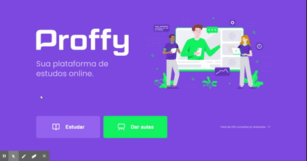

<p align="center">
  
</p>

<p align="center">
  
  
  <a href="https://rafaelfachinelli.com">
    
  </a>
  
</p>

<p align="center">
  <a href="#eye_speech_bubble-preview">Preview</a> •
  <a href="#information_source-about">About</a> •
  <a href="#memo-tasks">Tasks</a> •
  <a href="#arrow_forward-run">Run</a> •
  <a href="#hammer_and_wrench-technologies">Technologies</a> •
  <a href="#boy-author">Author</a> •
  <a href="#balance_scale-license">License</a>
</p>

---

## :eye_speech_bubble: Preview

<div align="center">

|Study (web)|Give classes (web)|
|:---:|:---:|
|<kbd></kbd>|<kbd></kbd>|

|Study (app)|Give classes (app)|
|:---:|:---:|
|<kbd></kbd>|<kbd></kbd>|

</div>

---

## :information_source: About

👨‍🏫 A platform that connects students and private teachers. Teachers register their name, bio, WhatsApp, subject, price and the week days and hours they are available; students filter teachers by subject, day and time and contact them on WhatsApp, which counts as a connection. The app also keeps favorite teachers.

This is the advanced version, with a React web app, a Node.js API and a React Native app. Built in 2020 during Rocketseat's Next Level Week #2 (Omnistack track). The basic version, in HTML, CSS and JavaScript, is in [proffy-basic](https://github.com/rafaelfachinelli/proffy-basic).

---

## :memo: Tasks

<div align="center">
<details>
<summary>Click to view</summary>

<details>
<summary>🌐 Web</summary>

|State|Task|
|:---:|:---|
|:heavy_check_mark:|Landing page with the connections count|
|:heavy_check_mark:|Teacher list with filters|
|:heavy_check_mark:|Teacher registration form with schedules|
|:heavy_check_mark:|Integration with the API|

</details>

<details>
<summary>🗄️ Server</summary>

|State|Task|
|:---:|:---|
|:heavy_check_mark:|Express API with TypeScript|
|:heavy_check_mark:|SQLite database with Knex migrations|
|:heavy_check_mark:|Create and search classes by subject, day and time|
|:heavy_check_mark:|Create and count connections|

</details>

<details>
<summary>📱 Mobile</summary>

|State|Task|
|:---:|:---|
|:heavy_check_mark:|Landing, study and give classes screens|
|:heavy_check_mark:|Tab navigation|
|:heavy_check_mark:|Teacher list with filters|
|:heavy_check_mark:|Favorites saved in AsyncStorage|
|:heavy_check_mark:|Contact on WhatsApp|

</details>

</details>
</div>

---

## :arrow_forward: Run

You need [Node.js](https://nodejs.org/) and [Yarn](https://yarnpkg.com/). For the app, install [Expo Go](https://expo.dev/go) on your phone.

### Server

In the [`server/`](server/) folder:

```bash
yarn

# Create the SQLite database
yarn knex:migrate

# Start the API
yarn start
```

> The API starts at <http://localhost:3333>.

### Web

In the [`web/`](web/) folder:

```bash
yarn
yarn start
```

> The app opens at <http://localhost:3000>.

### Mobile

In the [`mobile/`](mobile/) folder:

```bash
yarn
yarn start
```

> Scan the QR code with Expo Go.

---

## :hammer_and_wrench: Technologies

<div align="center">

|Web|Server|Mobile|
|:---:|:---:|:---:|
|[React](https://react.dev/)|[Node.js](https://nodejs.org/)|[React Native](https://reactnative.dev/)|
|[TypeScript](https://www.typescriptlang.org/)|[Express](https://expressjs.com/)|[Expo](https://expo.dev/)|
|[React Router](https://reactrouter.com/)|[Knex](https://knexjs.org/)|[React Navigation](https://reactnavigation.org/)|
|[Axios](https://axios-http.com/)|[SQLite](https://www.sqlite.org/)|[AsyncStorage](https://react-native-async-storage.github.io/async-storage/)|

</div>

---

## :boy: Author

<div align="center">

<a href="https://rafaelfachinelli.com">
  
  <br/>
  <sub><b>Rafael Fachinelli</b></sub>
</a>

Tech Lead and software engineer. Get in touch!

[](https://rafaelfachinelli.com)
[](https://www.linkedin.com/in/rafaelfachinelli/)
[](https://github.com/rafaelfachinelli)
[](mailto:rafael.l.a.fachinelli@gmail.com)

</div>

---

## :balance_scale: License

This project is under the [MIT license](./LICENSE).
